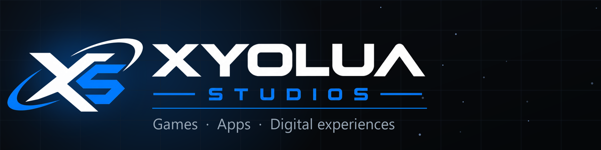

<!-- XYOLUA STUDIOS · GitHub profile README -->
<div align="center">



<br/>

### `Indie studio` · `building games, apps & web experiences`


</div>

---

## ◆ About

```ts
const xyolua = {
  role:     "Founder & developer @ XYOLUA Studios",
  building: ["games", "web apps", "tools & dashboards"],
  focus:    "clean design, things that actually ship",
  status:   "always building something",
};
```

I'm the developer behind **XYOLUA Studios** — a one-person studio where I design, build
and ship my own projects end to end: from the first line of code to the launch video.
I like products that feel polished and do one thing really well.

## ◆ Tech

<p>


</p>

## ◆ What I'm working on

- 🎮 **Games** — tycoon & simulation projects
- 📊 **Dashboards & tools** — real-time data, clean UIs
- 🌐 **Web apps** — fast, self-hosted, no bloat

## ◆ Stats

<div align="center">


<br/>


</div>

<div align="center">
<br/>
<sub>◆ <b>XYOLUA STUDIOS</b> ◆</sub>
</div>
